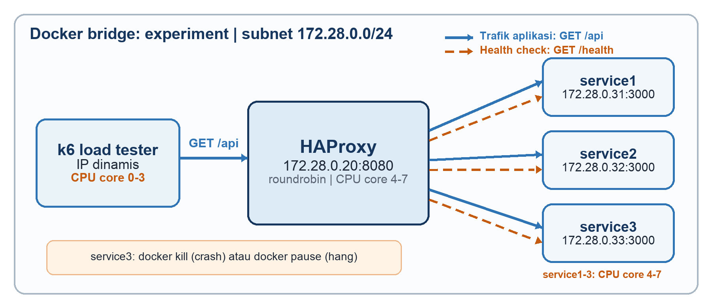
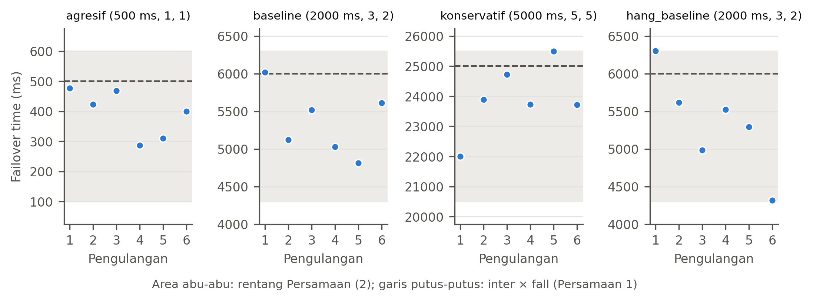
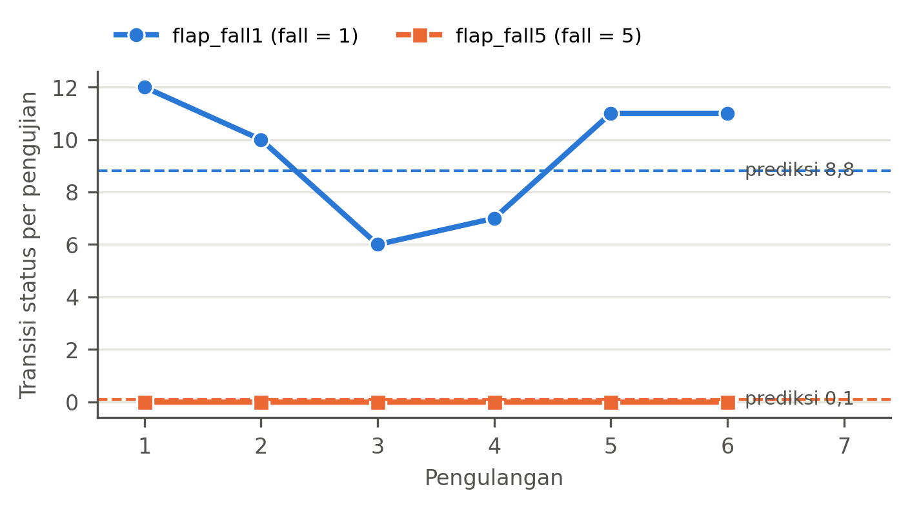

<!--
SMART COMP MANUSCRIPT SOURCE (template; double-brace names are placeholders).
fill_smartcomp_manuscript.py replaces the placeholders with values computed from
the `make fast` runs and writes manuscript/smartcomp-manuscript.md, which
build_smartcomp_docx.py turns into the journal DOCX. Edit this file, not the
filled copy.

Journal rules applied (Author Guidelines, Smart Comp, checked 2026-10-30):
Bahasa Indonesia; title 10-15 words; abstract 150-200 words in one paragraph;
3-5 keywords separated by semicolons; sections Pendahuluan, Metode Penelitian,
Hasil dan Pembahasan, Kesimpulan, Ucapan Terima Kasih, Daftar Pustaka; IEEE
references numbered by first appearance; at least 10 references, journal and
proceeding references from the last 5 years; at least one Smart Comp article.
Author rules kept from the SKANIKA versions: the first abstract sentences and
the future-work paragraph are the author's own wording (verbatim); no em dash;
"Sub bagian"; RPS (Requests per Second).
-->

@title-id: Praktik Terbaik Health Check HAProxy pada Microservice Perbankan dan E-Commerce: Kecepatan dan Akurasi Deteksi Kegagalan
@authors: Christianto Elvern Haryanto^1^, Mychael Maoeretz Engel^2^, Agustinus Bimo Gumelar^*3^
@affiliation: ^1,2,3)^Program Studi Informatika, Fakultas Teknologi Informasi, Universitas Ciputra, Surabaya
@email: Email: ^1^charyanto@student.ciputra.ac.id, ^2^mychael.engel@ciputra.ac.id, ^*3^bimo.gumelar@ciputra.ac.id
@abstrak: Dalam kondisi tertentu, microservice dapat mengalami failover yang mengharuskan permintaan pengguna diarahkan menuju instance microservice tertentu yang tidak dapat merespons. Kondisi tersebut menunjukkan pentingnya konfigurasi parameter health check yang tepat, karena pemeriksaan ketersediaan dan respons microservice yang terlalu sensitif, dapat menganggap gangguan sementara sebagai bentuk kegagalan layanan dan memicu proses failover secara berulang. Pemeriksaan berkala (health check) HAProxy merupakan failure detector yang harus menyeimbangkan kecepatan dan akurasi deteksi, tetapi penelitian terdahulu hanya membandingkan algoritma pembagian trafik atau mengukur failover tanpa memvariasikan parameter deteksi. Penelitian ini mengevaluasi kedua sisi tersebut dengan menguji tiga profil parameter inter, fall, dan rise pada kegagalan crash dan hang serta dua nilai fall pada kegagalan intermiten melalui 36 pengujian otomatis berurutan acak dengan 200 pengguna virtual. Uji permutasi dan interval kepercayaan bootstrap menunjukkan failover time {{FO_MIN}} hingga {{FO_MAX}} ms dan throughput profil agresif {{TP_GAIN}}% lebih tinggi daripada profil konservatif, sedangkan latensi tidak berbeda. Sebaliknya, nilai fall = 1 menghasilkan {{F1_TR}} transisi status per pengujian dan mengeluarkan {{F1_CAP}}% kapasitas dari rotasi secara keliru. Model waktu deteksi dan model flapping yang diusulkan memprediksi kedua sisi tersebut, sehingga hasilnya menjadi praktik terbaik pemilihan parameter health check bagi industri perbankan dan e-commerce.
@kata-kunci: failure detector; failover time; HAProxy; health check; microservice
@title-en: HAProxy Health Check Best Practice for Banking and E-Commerce Microservices: Failure Detection Speed and Accuracy
@abstract: Under certain conditions, a microservice may experience a failover in which user requests are directed to a particular microservice instance that is unable to respond. This highlights the importance of configuring health-check parameters appropriately, as checks that are overly sensitive to microservice availability and responsiveness may interpret a temporary disruption as a service failure and repeatedly trigger the failover process. HAProxy health checks are failure detectors that must balance detection speed against accuracy, yet previous studies have only compared traffic-distribution algorithms or measured failover without varying the detection parameters. This study evaluates both sides by testing three inter, fall and rise profiles under crash and hang failures and two fall values under intermittent failure, in 36 randomised automated runs with 200 virtual users. Permutation tests and bootstrap confidence intervals show failover times of {{FO_MIN_EN}} to {{FO_MAX_EN}} ms and {{TP_GAIN_EN}}% higher throughput for the aggressive than the conservative profile, with no latency difference. Conversely, fall = 1 caused {{F1_TR_EN}} status transitions per run and wrongly removed {{F1_CAP_EN}}% of capacity from rotation. The proposed detection-time and flapping models predict both sides, so the results serve as best practice for choosing health-check parameters in the banking and e-commerce industries.
@keywords: failure detector; failover time; HAProxy; health check; microservice

# Pendahuluan

Arsitektur microservice dengan mekanisme load balancing dan failover banyak digunakan pada sistem yang menuntut ketersediaan tinggi karena memungkinkan layanan direplikasi, diskalakan, dan dipulihkan secara independen. Industri perbankan dan e-commerce bergantung pada arsitektur ini: perbankan beralih dari arsitektur monolitik ke microservice demi tuntutan layanan digital [1], dan e-commerce menerapkan load balancing dan failover untuk mencegah downtime saat server utama gagal [2]. Di kedua industri tersebut, setiap detik trafik diarahkan ke instance yang gagal berarti transaksi pembayaran atau pesanan gagal, sedangkan instance laik yang dikeluarkan secara keliru mengurangi kapasitas saat beban puncak. Penelitian terdahulu menunjukkan bahwa penerapan mekanisme ketersediaan tinggi pada arsitektur microservice berbasis container dapat meningkatkan kualitas layanan dibandingkan arsitektur monolitik [3], metode kendali ketersediaan tinggi pada aplikasi microservice yang tersebar pada beberapa klaster dikembangkan untuk mempersingkat waktu pemulihan layanan [4], dan sistem ketahanan berbasis faktor toleransi kesalahan dikembangkan untuk arsitektur microservice [5]. Dalam implementasinya, load balancer berperan dalam menentukan distribusi permintaan sekaligus mengarahkan trafik dari layanan yang mengalami kegagalan menuju instance yang masih dapat melayani permintaan. HAProxy merupakan salah satu perangkat lunak load balancer yang digunakan pada lingkungan web server, container, maupun klaster orkestrasi [6]. Penelitian pada load balancing web server berbasis container Docker Swarm menguji keandalan web server saat menangani lonjakan permintaan [7], sedangkan penelitian pada HAProxy membandingkan algoritma round robin dan least connection serta menunjukkan bahwa pemilihan algoritma distribusi trafik berpengaruh terhadap kinerja server [8]. Kajian pada ingress controller menunjukkan bahwa perbedaan algoritma load balancing dapat mempengaruhi efisiensi dan kinerja sistem ter kontainer [9], sedangkan penelitian pada lingkungan on-premise dan cloud computing memperlihatkan bahwa penerapan load balancer berpengaruh terhadap kinerja layanan web [10]. Pengukuran failover juga telah dilakukan pada perbandingan orkestrator Kubernetes dan Docker Swarm [11] serta pada analisis kinerja high availability cluster berbasis heartbeat [12], sedangkan metode graceful failover dikembangkan untuk mengurangi gangguan pada microservice stateful berlatensi rendah [13]. Penelitian pada pemantauan container di Kubernetes menunjukkan bahwa pemeriksaan berkala dapat mengalami keterlambatan dalam mendeteksi perubahan status, sedangkan konfigurasi pemeriksaan yang dipercepat menimbulkan deteksi kegagalan yang keliru sehingga ketersediaan layanan menurun [14]. Kompromi tersebut merupakan persoalan dasar failure detector, yang kualitasnya dinilai dari dua sisi yang saling berlawanan, yaitu waktu deteksi dan tingkat kesalahan penilaian status [15]. Health check pada load balancer juga merupakan failure detector, tetapi kajian pada HAProxy masih berfokus pada algoritma load balancing [8] dengan health check pada nilai bawaan, sedangkan pengukuran failover [11], [12] dilakukan pada tingkat orkestrator atau klaster dengan resolusi detik hingga menit, tanpa memvariasikan parameter deteksi dan tanpa mengukur penandaan status yang keliru. Dengan demikian, terdapat celah penelitian berupa belum adanya evaluasi health check load balancer sebagai failure detector pada kedua sisi sekaligus, yaitu seberapa cepat instance yang gagal dikeluarkan dari rotasi dan seberapa sering instance yang laik dikeluarkan secara keliru, karena dokumentasi HAProxy hanya mendefinisikan fungsi parameternya [16] dan kajian penyetelan HAProxy berfokus pada metode pembagian beban [17].

Celah tersebut menjadi penting karena HAProxy menentukan kapan sebuah instance dianggap tidak laik menerima trafik berdasarkan konfigurasi health check. Parameter inter menentukan interval antar pemeriksaan, fall menentukan jumlah kegagalan pemeriksaan berturut-turut sebelum instance dinyatakan DOWN, sedangkan rise menentukan jumlah keberhasilan pemeriksaan berturut-turut sebelum instance dinyatakan pulih [16]. Nilai inter atau fall yang kecil mempercepat deteksi, tetapi sensitivitas yang terlalu tinggi dapat membuat gangguan sementara dianggap sebagai kegagalan dan menyebabkan perubahan status berulang (flapping). Sebaliknya, konfigurasi yang lebih konservatif mengurangi perubahan status yang tidak diperlukan, tetapi memperpanjang waktu ketika permintaan masih diarahkan menuju instance yang tidak dapat merespons. Dengan kata lain, inter dan fall menentukan sisi kecepatan, yaitu waktu deteksi, sedangkan fall dan rise menentukan sisi akurasi, yaitu seberapa sering dan seberapa lama instance yang laik ditandai DOWN. Karena itu, penelitian ini mengevaluasi health check HAProxy sebagai failure detector pada kedua sisi tersebut. Sisi kecepatan diuji dengan tiga profil konfigurasi, yaitu profil agresif, profil bawaan HAProxy, dan profil konservatif, terhadap failover time, throughput, latensi, dan error rate pada sistem microservice berbasis Docker, baik pada kegagalan crash maupun hang. Sisi akurasi diuji dengan mengukur frekuensi perubahan status dan kapasitas yang hilang pada kegagalan intermiten, yang dinyatakan dengan probabilitas kegagalan p, yaitu peluang sebuah pemeriksaan menghasilkan status tidak laik meskipun proses layanan tetap berjalan. Kontribusi penelitian ini adalah (1) evaluasi health check HAProxy pada kedua sisi failure detector, yaitu waktu deteksi pada kegagalan crash dan hang serta penandaan keliru pada kegagalan intermiten, dengan uji permutasi dan interval kepercayaan bootstrap, (2) model yang menghubungkan inter, fall, dan rise dengan rentang waktu deteksi serta dengan frekuensi flapping dan kapasitas yang hilang, dan (3) prosedur pengukuran terotomasi dan teracak yang dapat direplikasi dalam waktu kurang dari satu jam, serta (4) praktik terbaik konfigurasi health check bagi layanan perbankan dan e-commerce. Penelitian selanjutnya dapat memperluas pengujian pada lingkungan Linux bare-metal, orchestrator seperti Kubernetes, serta berbagai tingkat probabilitas kegagalan intermiten untuk mengetahui generalisasi hasil dan memodelkan hubungan antara konfigurasi health check, waktu deteksi, dan frekuensi flapping secara lebih luas.

# Metode Penelitian

Penelitian menggunakan pendekatan eksperimen kuantitatif dengan variabel bebas berupa profil nilai parameter health check HAProxy dan jenis kegagalan, serta variabel terikat berupa failover time, throughput, latensi p50, latensi p95, error rate, dan frekuensi transisi status. Variabel kontrol mencakup jumlah instance layanan, alokasi sumber daya container, jumlah virtual user, durasi pengujian, dan waktu injeksi kegagalan. Latensi p50 (median) menunjukkan nilai yang tidak dilampaui oleh 50% permintaan, sedangkan latensi p95 menunjukkan nilai yang hanya dilampaui oleh 5% permintaan dan lazim digunakan sebagai batas Service Level Objective (SLO) layanan [18].

## Arsitektur Lingkungan Pengujian

Lingkungan pengujian dibangun menggunakan Docker Compose dan terdiri atas satu container HAProxy, tiga container layanan yang identik, serta satu container load tester k6 pada jaringan bridge internal `experiment` dengan subnet 172.28.0.0/24, sebagaimana ditunjukkan pada Gambar 1. k6 mengirim permintaan `GET /api` ke HAProxy pada 172.28.0.20:8080, dan HAProxy membagi trafik tersebut dengan algoritma roundrobin ke `service1`, `service2`, dan `service3` pada port 3000. Secara terpisah, HAProxy mengirim permintaan `GET /health` ke setiap instance untuk menentukan status UP atau DOWN. Layanan yang diuji merupakan aplikasi Node.js dengan endpoint `/api` yang mensimulasikan pekerjaan selama kurang lebih 5 ms dan endpoint `/health` yang dapat dikonfigurasi untuk mengembalikan respons tidak laik secara probabilistik.

{width=16}

Spesifikasi platform disajikan pada Tabel 1. Docker Desktop pada macOS menjalankan container di dalam virtual machine Linux dengan alokasi tetap 8 CPU dan 16 GB RAM. Agar load tester tidak bersaing dengan sistem yang diuji, k6 dibatasi pada core 0 sampai 3, sedangkan HAProxy dan ketiga layanan dibatasi pada core 4 sampai 7 menggunakan pengaturan cpuset Docker. Seluruh image merupakan image ARM64 native, dan aplikasi lain pada host ditutup selama pengujian.

Tabel 1. Spesifikasi platform implementasi
| Komponen | Spesifikasi |
|---|---|
| Perangkat | Apple MacBook Pro (Apple M5, ARM64), CPU 10-core, RAM 24 GB, SSD 1 TB |
| Sistem operasi host | macOS Tahoe 26.6.2 |
| Runtime container | Docker Desktop 4.75.0 (Docker Engine 29.5.2, Docker Compose v5.1.3), alokasi 8 CPU dan 16 GB RAM |
| Pembagian CPU | k6: core 0-3; HAProxy dan service1-3: core 4-7 |
| Load balancer | HAProxy 3.2 (haproxy:3.2-alpine), mode HTTP, roundrobin, timeout connect dan timeout check 100 ms |
| Load tester | k6 1.3.0, executor constant-vus, 200 virtual user, timeout permintaan 5 s |

## Skenario Pengujian

Enam skenario diuji sebagaimana disajikan pada Tabel 2. Profil baseline menggunakan nilai bawaan HAProxy, yaitu inter = 2000 ms, fall = 3, dan rise = 2 [16], sehingga menjadi titik acuan konfigurasi yang paling banyak dijumpai pada penerapan nyata. Profil agresif memprioritaskan kecepatan deteksi, sedangkan profil konservatif memprioritaskan kestabilan status, sejalan dengan pembandingan konfigurasi probe bawaan dan probe cepat pada Kubernetes [14]. Ketiga profil diuji pada kegagalan crash, yaitu container `service3` dihentikan dengan `docker kill`. Skenario hang_baseline menggunakan parameter baseline, tetapi `service3` dibekukan dengan `docker pause`, sehingga proses tetap ada namun tidak menjawab permintaan. Dua skenario flapping menguji kegagalan intermiten, yaitu endpoint `/health` mengembalikan status tidak laik secara acak dengan p = 0,3 pada setiap pemeriksaan, sedangkan endpoint `/api` tetap melayani permintaan secara normal. Nilai p = 0,3 dipilih sebagai kegagalan intermiten tingkat sedang yang cukup sering untuk memicu perubahan status pada nilai fall rendah tanpa menyerupai kegagalan total. Setiap skenario diulang enam kali sehingga total pengujian berjumlah 36 kali.

Tabel 2. Skenario konfigurasi parameter health check
| Skenario | inter (ms) | fall | rise | Jenis kegagalan |
|---|---|---|---|---|
| agresif | 500 | 1 | 1 | Crash (`docker kill`) |
| baseline | 2000 | 3 | 2 | Crash (`docker kill`) |
| konservatif | 5000 | 5 | 5 | Crash (`docker kill`) |
| hang_baseline | 2000 | 3 | 2 | Hang (`docker pause`) |
| flap_fall1 | 2000 | 1 | 2 | Intermiten (p = 0,3 per pemeriksaan) |
| flap_fall5 | 2000 | 5 | 2 | Intermiten (p = 0,3 per pemeriksaan) |

## Prosedur Pengujian dan Pengukuran

Setiap pengulangan membangun ulang seluruh stack container dengan konfigurasi HAProxy yang dibangkitkan dari templat, menunggu warm-up 15 detik, lalu menjalankan load test, yaitu pembangkitan permintaan secara serentak untuk mengukur kapasitas layanan [19], selama 60 detik dengan 200 virtual user yang mengirim permintaan `GET /api` secara berulang tanpa jeda. Pada skenario crash dan hang, kegagalan diinjeksikan pada detik ke-15 ditambah penundaan acak antara nol dan satu nilai inter, lalu instance dipulihkan pada detik ke-50. Penundaan acak tersebut membuat titik kegagalan jatuh pada fase yang berbeda di dalam siklus pemeriksaan pada setiap pengulangan, sehingga failover time mewakili titik kegagalan yang acak dan bukan satu fase yang tetap. Urutan ke-36 pengujian juga diacak agar perubahan kondisi host selama pengujian tidak bercampur dengan perbedaan antar skenario. Penundaan dan urutan dibangkitkan dari seed yang tetap sehingga dapat direplikasi.

Perintah `docker kill` mengirim SIGKILL yang tidak dapat ditangkap proses, sehingga container berhenti seketika dan titik awal kegagalan dapat ditentukan secara tepat, berbeda dengan `docker stop` yang mengirim SIGTERM dan menunggu tenggang waktu 10 detik. Perintah `docker pause` membekukan seluruh proses container tanpa menghentikannya, sehingga koneksi ke instance tersebut tidak dijawab hingga batas waktu tercapai. Failover time diukur sebagai selisih dua timestamp yang keduanya bersumber dari clock Docker daemon untuk menghindari clock skew antara host dan virtual machine. Timestamp pertama adalah atribut `State.FinishedAt` untuk kegagalan crash atau waktu event `pause` dari `docker events` untuk kegagalan hang, sedangkan timestamp kedua adalah baris log HAProxy `"Server ... is DOWN"`. Nilai teoretis failover time dihitung dengan Persamaan (1). Karena titik kegagalan dapat jatuh di mana saja di dalam siklus pemeriksaan, setiap pemeriksaan yang gagal berlangsung hingga timeout check (t~timeout~ = 100 ms), dan pemeriksaan berikutnya baru dijadwalkan satu interval setelah pemeriksaan sebelumnya selesai, failover time empiris diprediksi berada pada rentang Persamaan (2). Apabila fase kegagalan terdistribusi seragam, rata-rata failover time diharapkan sebesar inter × (fall − 0,5) + fall × t~timeout~ dengan simpangan baku inter/√12.

$$1$$

$$2$$

Pada skenario flapping, metrik yang dicatat adalah jumlah transisi status UP dan DOWN serta durasi status DOWN selama jendela load test. Karena endpoint `/api` tetap melayani permintaan, setiap status DOWN pada skenario ini merupakan penandaan yang keliru, dan kapasitas yang hilang dinyatakan sebagai durasi DOWN dibagi tiga kali panjang jendela pengujian. Apabila setiap pemeriksaan gagal secara independen dengan probabilitas p, waktu rata-rata instance bertahan UP sama dengan waktu tunggu hingga terjadi fall kegagalan berturut-turut, dan waktu rata-rata DOWN sama dengan waktu tunggu hingga terjadi rise keberhasilan berturut-turut, sebagaimana dinyatakan Persamaan (3) dan (4). Jumlah transisi yang diharapkan selama jendela W dan proporsi waktu DOWN dinyatakan pada Persamaan (5).

$$3$$

$$4$$

$$5$$

## Pipeline Otomasi

Seluruh tahapan dijalankan oleh skrip otomasi tanpa intervensi manual sebagaimana disajikan pada Tabel 3, sehingga ke-36 pengujian dijalankan dengan prosedur yang identik. Seluruh artefak mentah setiap pengulangan, termasuk log HAProxy, ringkasan dan data mentah k6, serta versi image, disimpan untuk keperluan audit.

Tabel 3. Pipeline otomasi untuk satu pengulangan (Algoritma 1)
| Langkah | Tindakan |
|---|---|
| 1 | Acak urutan pasangan (skenario, pengulangan) dengan seed tetap |
| 2 | Render `haproxy.cfg` dari templat (inter, fall, rise, timeout 100 ms) |
| 3 | `docker compose down -v`; `docker compose up -d --build`; warm-up 15 s |
| 4 | Jalankan k6 (constant-vus, 200 VU, 60 s) pada core 0-3 |
| 5 | Crash: `docker kill service3`; hang: `docker pause service3`; pada t = 15 s + U(0, inter) |
| 6 | Pada t = 50 s: `docker start` atau `docker unpause` |
| 7 | Catat waktu kegagalan dari `State.FinishedAt` atau event `pause` |
| 8 | Ekstraksi waktu DOWN, transisi status, dan durasi DOWN dari log HAProxy |
| 9 | Ekstraksi throughput, p50, p95, dan error rate dari ringkasan k6; simpan ke `results.csv` |

## Pilot Study sebagai Gerbang Validasi

Pilot study menggunakan konfigurasi baseline dengan tiga pengulangan. Pengujian utama dilaksanakan apabila lima kriteria terpenuhi: (1) failover time dapat diekstraksi pada seluruh pengulangan; (2) selisih failover time antar pengulangan tidak melebihi satu nilai inter ditambah durasi pemeriksaan, karena fase kegagalan sengaja diacak dalam rentang satu interval; (3) penggunaan CPU load tester berada di bawah 80% dari empat core yang dialokasikan; (4) seluruh error terjadi dalam jendela kegagalan; dan (5) pipeline berjalan penuh tanpa intervensi manual.

## Teknik Analisis Data

Data dianalisis dengan dua metode yang tidak mengasumsikan distribusi normal dan sesuai untuk enam pengulangan per skenario. Pertama, interval kepercayaan 95% untuk rata-rata setiap skenario dan untuk selisih rata-rata antar skenario dihitung dengan metode bootstrap persentil sebanyak 10.000 resampling. Kedua, perbedaan rata-rata antar dua skenario diuji dengan uji permutasi eksak dua sisi yang menghitung seluruh 924 kemungkinan pembagian data dua kelompok berukuran enam. Perbandingan antar tiga profil dikoreksi dengan metode Holm untuk tiga pasangan, dan perbedaan dinyatakan signifikan apabila p-value < 0,05. Prediksi Persamaan (2) sampai (5) dinyatakan sesuai apabila nilai prediksi berada di dalam interval kepercayaan bootstrap 95% dari rata-rata hasil pengukuran.

# Hasil dan Pembahasan

## Hasil Pilot Study

Seluruh kriteria gerbang validasi terpenuhi, sebagaimana disajikan pada Tabel 4. Failover time berhasil diekstraksi pada ketiga pengulangan dengan selisih maksimum {{PILOT_SPREAD}} ms, di bawah batas 2100 ms, dan seluruh nilainya berada di dalam rentang Persamaan (2). Penggunaan CPU load tester paling tinggi {{PILOT_CPU}}% dari empat core yang dialokasikan. Seluruh {{PILOT_ERRORS}} permintaan gagal tercatat di antara saat instance dimatikan hingga sesaat setelah HAProxy menandainya DOWN, dan pipeline berjalan tanpa intervensi manual, sehingga pengujian utama dilanjutkan.

Tabel 4. Hasil pilot study pada konfigurasi baseline
| Pengulangan | Throughput (RPS) | p50 (ms) | p95 (ms) | Error rate (%) | Failover time (ms) |
|---|---|---|---|---|---|
{{PILOT_ROWS}}

Keterangan: RPS = Requests per Second, yaitu jumlah permintaan HTTP yang diproses per detik.

## Statistik Deskriptif

Tabel 5 merangkum rata-rata dan standar deviasi metrik pada keenam skenario. Failover time tidak tersedia pada skenario flapping karena tidak terdapat titik kegagalan tunggal.

Tabel 5. Statistik deskriptif per skenario (rata-rata ± standar deviasi, n = 6)
| Skenario | Throughput (RPS) | p50 (ms) | p95 (ms) | Error rate (%) | Failover (ms) |
|---|---|---|---|---|---|
{{DESC_ROWS}}

Profil konservatif menghasilkan throughput terendah sebesar {{KON_TP}} RPS dengan error rate tertinggi di antara profil crash sebesar {{KON_ERR}}%, sedangkan profil agresif mempertahankan throughput {{AGR_TP}} RPS dengan error rate {{AGR_ERR}}%, sehingga throughput profil agresif {{TP_GAIN}}% lebih tinggi. Perbedaan ini bersumber dari lamanya periode ketika HAProxy masih mengarahkan trafik ke instance yang sudah mati. Permintaan gagal pertama tercatat sekitar 0,41 detik setelah instance dimatikan, sesuai dengan empat upaya koneksi, yaitu satu upaya awal dan tiga retries bawaan HAProxy [16], yang masing-masing dibatasi timeout connect 100 ms, sehingga selama jendela deteksi sebagian besar virtual user tertahan pada permintaan menuju instance mati. Akibatnya, dampak keterlambatan deteksi terhadap throughput jauh lebih besar daripada dampaknya terhadap jumlah permintaan yang gagal. Sebaliknya, latensi p50 dan p95 pada keenam skenario berada pada kisaran yang sama karena permintaan yang berhasil tetap dilayani oleh instance yang laik.

## Perbandingan Antarprofil

Tabel 6 menyajikan selisih rata-rata antar profil beserta interval kepercayaan bootstrap 95% dan p-value uji permutasi terkoreksi Holm.

Tabel 6. Selisih rata-rata antar profil kegagalan crash [IK bootstrap 95%] dan p-value permutasi (Holm)
| Pasangan | Failover time (ms) | Error rate (%) | Throughput (RPS) | p95 (ms) |
|---|---|---|---|---|
{{PAIR_ROWS}}

{{PAIR_TEXT}}

## Sisi Kecepatan: Failover Time Empiris dan Teoretis

Tabel 7 dan Gambar 2 membandingkan failover time hasil pengukuran dengan nilai teoretis. {{EQ_TEXT}}

Tabel 7. Failover time empiris terhadap Persamaan (1) dan (2)
| Skenario | Rentang Persamaan (2) (ms) | Min-maks (ms) | Rata-rata [IK 95%] (ms) | Prediksi fase seragam (ms) | Teoretis inter × fall (ms) |
|---|---|---|---|---|---|
{{EQ_ROWS}}

{width=16.5}

{{EQ_TEXT2}}

## Kegagalan Crash dan Hang

{{HANG_TEXT}}

## Sisi Akurasi: Nilai fall terhadap Flapping

Tabel 8 dan Gambar 3 menyajikan transisi status dan durasi DOWN pada kedua skenario flapping.

Tabel 8. Transisi status dan durasi DOWN per pengujian selama jendela load test
| Pengulangan | flap_fall1 transisi | flap_fall1 DOWN (s) | flap_fall5 transisi | flap_fall5 DOWN (s) |
|---|---|---|---|---|
{{FLAP_ROWS}}

{width=11}

{{FLAP_TEXT}}

## Perbandingan dengan Penelitian Terdahulu

Hasil penelitian dibandingkan dengan lima penelitian dalam rentang lima tahun terakhir yang mengukur kinerja load balancer, failover, atau deteksi kegagalan, sebagaimana disajikan pada Tabel 9.

Tabel 9. Perbandingan dengan penelitian terdahulu
| Aspek | Penelitian ini | [14] | [3] | [8] | [11] | [12] |
|---|---|---|---|---|---|---|
| Objek | Health check HAProxy | Probe Kubernetes | Eureka, Spring Cloud | Algoritma HAProxy | Kubernetes vs Docker Swarm | Heartbeat |
| Sisi failure detector yang diukur | kecepatan dan akurasi | kecepatan dan akurasi | tidak ada | tidak ada | kecepatan | kecepatan |
| Parameter deteksi divariasikan | 3 profil, 2 nilai fall | 2 konfigurasi | tidak dilaporkan | tidak | tidak | tidak dilaporkan |
| Jenis kegagalan | crash, hang, intermiten | crash, hang | tidak dijelaskan | tidak ada | service, node | shutdown, restart |
| Resolusi waktu deteksi | milidetik | detik | tidak dilaporkan | tidak diukur | detik | menit (MTTR) |
| Beban | {{LOAD_RANGE}} RPS | 100 req/s | 500-2000 thread | 500-900 koneksi/s | unggah berkas | 100 req/s |
| Pengulangan | 6, urutan acak | 30 | tidak dilaporkan | 5 | 30 (unggah) | 30 |
| Uji statistik | permutasi, bootstrap | rata-rata ± SD | AHP | tidak ada | tidak ada | rata-rata |
| Model terhadap pengukuran | failover dan flapping | waktu deteksi | tidak ada | tidak ada | tidak ada | tidak ada |
| Biaya deteksi keliru | {{F1_CAP}}% kapasitas | ketersediaan −4% | tidak diukur | tidak diukur | tidak diukur | tidak diukur |
| Lingkungan uji | 1 host, core terpisah | VM Linux | server cloud | 5 mesin fisik | 2 laptop, VM | OpenStack |

Dibandingkan kelima penelitian tersebut, penelitian ini merupakan satu-satunya yang mengevaluasi health check load balancer pada kedua sisi failure detector, memvariasikan parameternya secara sistematis, mengukur failover time dengan resolusi milidetik dari clock yang sama, dan menguji perbedaan dengan statistik inferensial beserta interval kepercayaan. Hanya [14] yang juga mengukur kedua sisi, tetapi pada probe Kubernetes yang menanggapi deteksi dengan restart container. Hasilnya konsisten dengan [14]: hasil kali interval dan ambang kegagalan menentukan waktu deteksi, dengan waktu deteksi konfigurasi bawaan {{RATIO}} kali konfigurasi cepat pada penelitian ini dan 12 kali pada [14]. Health check HAProxy mencapai waktu deteksi di bawah satu detik karena interval pemeriksaan dapat ditetapkan dalam milidetik, sedangkan konfigurasi tercepat pada [14] menggunakan periode 1 detik. Biaya deteksi keliru ditentukan oleh tindakan yang diambil mekanisme pemeriksaan. Pada [14], probe yang keliru memicu restart container sehingga ketersediaan turun dan permintaan gagal bertambah, sedangkan pada penelitian ini status DOWN yang keliru hanya mengeluarkan satu dari tiga replika dari rotasi sehingga tidak terjadi kehilangan permintaan selama kapasitas cadangan tersedia. Di sisi lain, [14] menggunakan aplikasi benchmark microservice yang lebih realistis dan pengulangan yang lebih banyak, sedangkan [8] dan [12] menjalankan load tester pada mesin terpisah; keterbatasan ini dibahas pada Sub bagian 3.9.

## Rekomendasi Konfigurasi sebagai Praktik Terbaik Industri

Tabel 10 menerjemahkan hasil pengujian menjadi praktik terbaik konfigurasi health check bagi industri perbankan dan e-commerce dengan memetakan setiap profil ke contoh layanan yang memiliki kebutuhan serupa. Layanan pembayaran dan checkout paling diuntungkan oleh deteksi cepat, karena pada profil konservatif instance yang mati masih menerima trafik selama {{KON_FO_S}} detik dan throughput turun {{KON_TP_LOSS}}% dibandingkan profil agresif. Namun, deteksi cepat dengan fall = 1 hanya aman apabila tersedia replika cadangan, karena pada kegagalan intermiten profil tersebut mengeluarkan {{F1_CAP}}% kapasitas dari rotasi secara keliru. Rekomendasi tersebut bersifat kondisional terhadap jenis kegagalan yang diantisipasi dan kapasitas cadangan yang tersedia. Untuk kondisi di antara profil tersebut, Persamaan (3) sampai (5) dapat digunakan untuk memperkirakan frekuensi flapping dari probabilitas kegagalan pemeriksaan yang teramati sebelum nilai fall ditetapkan.

Tabel 10. Rekomendasi konfigurasi berdasarkan profil kebutuhan
| Profil | Contoh layanan perbankan dan e-commerce | Rekomendasi | Justifikasi berbasis hasil |
|---|---|---|---|
{{REC_ROWS}}

## Keterbatasan Penelitian

Pengujian dilakukan pada satu perangkat dengan Docker Desktop yang menjalankan container di dalam virtual machine Linux. Pembagian core CPU mencegah load tester bersaing dengan sistem yang diuji, tetapi seluruh komponen tetap berbagi host yang sama, sehingga nilai absolut throughput dan latensi belum tentu sama pada lingkungan lain [20]; failover time tidak terpengaruh karena seluruh timestamp bersumber dari clock Docker daemon. Load test menggunakan model beban tertutup dengan jumlah virtual user tetap, sehingga virtual user yang tertahan pada instance yang gagal menurunkan laju permintaan berikutnya dan dapat memperbesar dampak keterlambatan deteksi terhadap throughput. Layanan yang diuji merupakan aplikasi sederhana dengan tiga replika, jumlah pengulangan dibatasi enam per skenario, dan kegagalan intermiten hanya disimulasikan pada p = 0,3, sehingga Persamaan (3) sampai (5) baru divalidasi pada satu tingkat probabilitas dan dua nilai fall. Ketiga profil juga mengubah inter, fall, dan rise secara bersamaan sehingga kontribusi setiap parameter belum dipisahkan. Selain itu, aplikasi uji bukan sistem perbankan atau e-commerce yang sesungguhnya, sehingga pemetaan pada Tabel 10 perlu divalidasi dengan pola beban dan pola kegagalan produksi.

# Kesimpulan

Berdasarkan hasil pengujian, dapat disimpulkan hal-hal berikut.

{{CONCLUSION_ITEMS}}

Secara praktis, temuan tersebut dapat dijadikan praktik terbaik bagi operator layanan perbankan dan e-commerce: profil cepat untuk layanan transaksi yang memiliki replika cadangan, nilai bawaan HAProxy untuk layanan umum, dan nilai fall yang lebih besar untuk layanan yang sering mengalami gangguan intermiten.

Kelebihan penelitian ini terletak pada evaluasi health check sebagai failure detector pada sisi kecepatan dan akurasi sekaligus, pengukuran failover time beresolusi milidetik dengan titik kegagalan dan urutan pengujian teracak, pengujian statistik dengan uji permutasi dan interval kepercayaan bootstrap, serta model flapping yang tervalidasi, sedangkan kekurangannya terletak pada penggunaan satu host tervirtualisasi, aplikasi uji yang sederhana, dan satu tingkat probabilitas kegagalan intermiten.

Penelitian selanjutnya yang dapat dilakukan antara lain: yang pertama adalah mereplikasi pengujian pada lingkungan Linux bare-metal dan pada orkestrator container seperti Kubernetes untuk menilai sejauh mana pola deviasi failover time bersifat spesifik terhadap HAProxy. Berikutnya yang kedua adalah menambah variasi tingkat probabilitas kegagalan intermiten perlu diperluas agar hubungan antara tingkat kegagalan, nilai fall, dan frekuensi flapping dapat dimodelkan secara kuantitatif. Yang ketiga, menyesuaikan nilai inter dan fall berdasarkan riwayat kelaikan instance layak diteliti sebagai upaya menurunkan waktu deteksi dan laju false positive secara bersamaan.

# Ucapan Terima Kasih

Penelitian ini didanai oleh hibah Universitas Ciputra melalui Program Dana Internal Penelitian Skema DIP Mahasiswa 2026 dengan nomor hibah 029/UC-LPPM/DIP-M/KP3/IX/2026.

# Daftar Pustaka

[1] B. Shojaiemehr and H. Yarahmadi, "Towards a Microservice Architecture for High-Quality Banking System: A Case Report and Review," *Concurrency and Computation: Practice and Experience*, vol. 38, no. 1, art. e70471, 2026, doi: 10.1002/cpe.70471.
[2] B. P. A. Pratama, B. G. Hardianto, and D. Dharmayanti, "Implementation of High Availability Based on Load Balancing and Failover Method in E-commerce Using MySQL Database," *Asian Journal of Engineering, Social and Health*, vol. 3, no. 10, pp. 2226–2239, 2024, doi: 10.46799/ajesh.v3i10.419.
[3] P. Zhang, L. Xiang, Z. Song, and Y. Yang, "Adaptive load balancing and fault-tolerant microservices architecture for high-availability web systems using docker and spring cloud," *Discover Applied Sciences*, vol. 7, no. 7, art. 705, 2025, doi: 10.1007/s42452-025-07320-7.
[4] B. Ramasamy, Y. Na, W. Kim, K. Chea, and J. Kim, "HACM: High Availability Control Method in Container-Based Microservice Applications Over Multiple Clusters," *IEEE Access*, vol. 11, pp. 3461–3471, 2023, doi: 10.1109/ACCESS.2022.3233159.
[5] K. R. Putra, S. Umaroh, N. F. Fahrudin, and P. W. Pandji, "Renovator: Resilience System in Microservices Architecture Using Fault Tolerance Factor," *MIND Journal*, vol. 10, no. 2, pp. 235–249, 2025, doi: 10.26760/mindjournal.v10i2.235-249.
[6] R. K. A. Pratama and Supatman, "Implementasi HAProxy sebagai external traffic load balancer cluster Kubernetes yang berjalan di atas Openstack," *Jurnal RESTIKOM: Riset Teknik Informatika dan Komputer*, vol. 6, no. 3, pp. 462–473, 2024, doi: 10.52005/restikom.v6i3.360.
[7] A. S. Wibawa, B. Arifwidodo, and E. Wahyudi, "Analisis Unjuk Kerja Load Balancing Web Server Menggunakan Virtualisasi Berbasis Container Docker Swarm," *Smart Comp: Jurnalnya Orang Pintar Komputer*, vol. 12, no. 3, pp. 590–599, 2023, doi: 10.30591/smartcomp.v12i3.4130.
[8] P. A. Laksono and S. D. Riskiono, "Analisis Perbandingan Algoritma Round Robin dan Least Connection dalam Haproxy untuk Load Balancer Server Web," *Dinamik*, vol. 30, no. 2, pp. 351–360, 2025, doi: 10.35315/dinamik.v30i2.10154.
[9] A. R. Khamdani, A. R. Muslikh, and A. S. Affandi, "Comparative Analysis of Performance and Efficiency of Load Balancing Algorithms on Ingress Controller," *Jurnal Teknik Informatika (JUTIF)*, vol. 6, no. 1, pp. 453–468, 2025, doi: 10.52436/1.jutif.2025.6.1.4040.
[10] R. F. Saleh and Kusrini, "Analisis Perbandingan Kinerja Web Humas Infrastruktur On-Premise dan Cloud Computing dengan Load Balancer Round Robin," *MALCOM: Indonesian Journal of Machine Learning and Computer Science*, vol. 5, no. 3, pp. 1107–1116, 2025, doi: 10.57152/malcom.v5i3.2182.
[11] Sugiyatno and I. M, "Analisis Perbandingan Performasi Respon Waktu Web Server dan Failover Antara Kubernetes Dan Docker Swarm pada Container Orchestration," *Jurnal Informatika Komputer, Bisnis dan Manajemen*, vol. 21, no. 3, pp. 43–53, 2023, doi: 10.61805/fahma.v21i3.9.
[12] N. Iryani, K. D. Ayatri, and R. D. Wahyuningrum, "Analisis performansi high availability cluster server menggunakan heartbeat pada private cloud," *JITEL (Jurnal Ilmiah Telekomunikasi, Elektronika, dan Listrik Tenaga)*, vol. 2, no. 2, pp. 129–138, 2022, doi: 10.35313/jitel.v2.i2.2022.129-138.
[13] K. Pakrijauskas and D. Mažeika, "A Method of Transparent Graceful Failover in Low Latency Stateful Microservices," *Electronics*, vol. 11, no. 23, art. 3936, 2022, doi: 10.3390/electronics11233936.
[14] J. Roberts, B. Archibald, and P. Trinder, "Signalling Health for Improved Kubernetes Microservice Availability," arXiv preprint arXiv:2507.02158, 2025, doi: 10.48550/arXiv.2507.02158.
[15] B. Chaurasia, A. Verma, and P. Verma, "IHFD: an improved heartbeat-based failure detector of ◊P (eventually perfect) class for partially synchronous hierarchical distributed systems," *Complex & Intelligent Systems*, 2026, doi: 10.1007/s40747-026-02423-z.
[16] HAProxy Technologies, "HAProxy version 3.2 – Configuration Manual," 2026. [Online]. Available: https://docs.haproxy.org/3.2/configuration.html. [Accessed: Sep. 3, 2026].
[17] C. Rawls and M. Amini Salehi, "Load Balancer Tuning: Comparative Analysis of HAProxy Load Balancing Methods," arXiv preprint arXiv:2212.14198, 2022, doi: 10.48550/arXiv.2212.14198.
[18] H. Hanada and K. Ishibashi, "Service-Level Objective-Aware Load-Adaptive Timeout: Balancing Failure Rate and Latency in Microservices Communication," *IEEE Access*, vol. 13, pp. 137881–137895, 2025, doi: 10.1109/ACCESS.2025.3596118.
[19] A. Annisa, M. Ardiana, P. N. Rahayu, T. Brian, and M. A. Jami'in, "Performance Evaluation of Web Applications Using JMeter Load Testing for Server Capacity and Response Efficiency," *Journal of Applied Informatics and Computing*, vol. 10, no. 1, pp. 585–590, 2026, doi: 10.30871/jaic.v10i1.11840.
[20] I. Čilić, P. Krivić, I. Podnar Žarko, and M. Kušek, "Performance Evaluation of Container Orchestration Tools in Edge Computing Environments," *Sensors*, vol. 23, no. 8, art. 4008, 2023, doi: 10.3390/s23084008.
